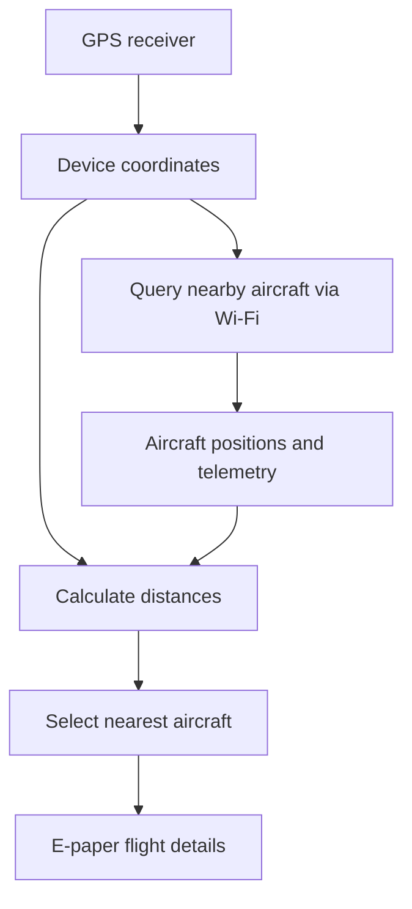

# LILYGO Flight Tracker ✈️

A standalone, GPS-based flight tracker built for the **LILYGO T5 E-Paper S3 Pro**. The device uses its GPS position to discover nearby aircraft over Wi-Fi and display information about the closest flight on its e-paper screen.

> **Project status:** Work in progress. Hardware examples and GPS functionality are being tested; the complete flight-tracking application and custom display interface are planned.

## What it does

The goal is to build a portable flight-spotting device that:

1. Determines its current position using the onboard GPS receiver.
2. Connects to Wi-Fi and requests nearby aircraft positions from a flight-tracking API.
3. Calculates the distance to each aircraft and selects the nearest one.
4. Displays available details such as callsign, distance, altitude, speed, and heading on the e-paper display.
5. Refreshes periodically as nearby aircraft change.

Flight number, airline, departure airport, and destination are potential future enhancements that may require an additional data source. GPS provides the device's location; it does **not** detect aircraft directly.

## Hardware

- **Board:** LILYGO T5 E-Paper S3 Pro (ESP32-S3)
- **Display:** 4.7-inch e-paper
- **Positioning:** GPS receiver on supported board variant
- **Connectivity:** Wi-Fi for aircraft data
- **Power:** USB or a compatible battery setup

See the [official hardware documentation](https://wiki.lilygo.cc/products/t5-series/t5-e-paper-s3-pro/) for board revisions, pinouts, and power requirements.

## How it works



The initial design uses a configurable search radius and selects the nearest airborne aircraft by distance. Data availability, update frequency, and API limits depend on the flight-data provider.

## Software stack

- **Language:** C++ (Arduino framework)
- **Development:** VS Code + PlatformIO
- **GPS parsing:** TinyGPSPlus
- **Networking:** ESP32 Wi-Fi and HTTP client
- **Aircraft data:** [OpenSky Network](https://opensky-network.org/) (planned integration)
- **Display:** LILYGO's board-specific display libraries and examples

## Getting started

The project is currently based on the [official LILYGO firmware repository](https://github.com/Xinyuan-LilyGO/T5S3-4.7-e-paper-PRO).

1. Install [Visual Studio Code](https://code.visualstudio.com/) and the [PlatformIO IDE](https://platformio.org/install/ide?install=vscode) extension.
2. Clone this repository and open it in VS Code.
3. Connect the board via USB.
4. Select the appropriate environment in `platformio.ini` for your hardware revision.
5. Build and upload a supported LILYGO example to verify the board, GPS, and display before running the custom application.

```bash
git clone https://github.com/YOUR_USERNAME/lilygo-flight-tracker.git
cd lilygo-flight-tracker
pio run
pio run -t upload
pio device monitor -b 115200
```

Replace `YOUR_USERNAME` with your GitHub username. Build commands assume the selected PlatformIO source directory and environment are configured correctly.

## Roadmap

- [ ] Verify the factory display example
- [ ] Verify GPS coordinates and satellite fix
- [ ] Implement Wi-Fi connectivity
- [ ] Integrate nearby aircraft lookup via OpenSky
- [ ] Calculate and filter aircraft distances
- [ ] Build the nearest-aircraft e-paper interface
- [ ] Add configurable refresh intervals and error handling
- [ ] Optimize battery usage and display refreshes
- [ ] Explore flight-route and airline enrichment

## References

- [LILYGO T5S3 4.7-inch E-Paper Pro — official GitHub repository](https://github.com/Xinyuan-LilyGO/T5S3-4.7-e-paper-PRO)
- [LILYGO T5 E-Paper S3 Pro — official documentation](https://wiki.lilygo.cc/products/t5-series/t5-e-paper-s3-pro/)
- [OpenSky Network](https://opensky-network.org/)
- [OpenSky REST API documentation](https://openskynetwork.github.io/opensky-api/rest.html)
- [PlatformIO documentation](https://docs.platformio.org/)

## Acknowledgements

This project builds on the hardware examples and libraries published by **LILYGO**. The original repository and its applicable licenses should be retained and respected when reusing source code.
